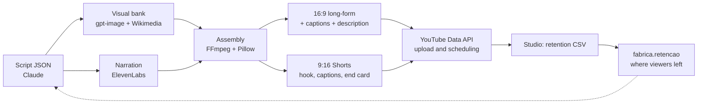

# AI Video Pipeline

[](https://github.com/rodrigomedeiros91-source/pipeline-video-ia/actions/workflows/tests.yml)

*[Leia em português](README.pt-BR.md)*

Two video-editing systems I built in Python, with AI at every step:

1. **History channel [The Myth Troll](https://www.youtube.com/@TheMythTroll)** (YouTube, in English): from script to published video. It writes the script, generates the illustrations, narrates, assembles the long-form video, cuts the Shorts and schedules everything through the YouTube API.
2. **Podcast clipper** (`podcast/`): turns a recorded episode into 30 Shorts, 5 long cuts, 5 mid-length cuts and covers. In production for a client.

## Results

| Long-form (16:9) | Short (9:16), one illustration per sentence |
| --- | --- |
|  |  |

Thumbnails made by the pipeline:

  

- 3 episodes published, each with 7 Shorts. Examples: [Who Ruled Italy](https://youtu.be/4_CfeSLyVeA) and [Wrong Inventors](https://youtu.be/uCsNsdAo85E).
- Shorts with 71–86% early retention in YouTube Studio, after tuning the hooks with `fabrica.retencao`.

## 1. History channel



| Module | What it does |
| --- | --- |
| `fabrica/roteiro.py` | Validates the script JSON (chapters, sentences, scenes) before spending on images and voice |
| `fabrica/visual.py`, `cenas.py`, `commons.py` | Generates scenes in the mascot's style (gpt-image) and finds freely licensed archive images |
| `fabrica/recortes.py` | Current format: one illustration per sentence, sentence on screen, hard cuts, series in Parts |
| `fabrica/montagem.py`, `clipes.py`, `camadas.py` | Builds the long-form video: narration, music with ducking, layers and transitions |
| `fabrica/shorts.py`, `vertical.py` | Cuts vertical Shorts with a hook, burned-in captions and an end card |
| `fabrica/youtube.py` | Uploads and schedules through the YouTube API, renewing the OAuth login on its own |
| `fabrica/referencias.py` | Finds outlier videos on a topic (views ÷ the channel's own median) |
| `fabrica/retencao.py` | Reads the Studio retention CSV and shows what the narration said where viewers left |
| `historia/` | Published scripts, mascot poses, fonts and style |

```bash
python -m fabrica.recortes who-ruled-italy --musica "track.mp3"   # long-form + Parts
python -m fabrica.shorts who-ruled-italy --musica "track.mp3" --inicio 2026-10-19
python -m fabrica.youtube who-ruled-italy                         # upload and schedule
```

## 2. Podcast clipper

`podcast/cortes.py` reads two files from the episode folder: `falantes.json`, the transcript with the speaker of every word (ElevenLabs Scribe), and `edicao.json`, the editorial decisions with the timestamps of each cut.

- **Face-tracking vertical crop:** detects faces with OpenCV YuNet and follows whoever is speaking, without switching shots on short interjections.
- **Word-by-word captions** in ASS, highlighting the word being spoken.
- **A Short structure that holds viewers:** a strong teaser, then the host's question, then the answer, with the logo sting landing over the speech.
- **Cover on the first frame**, with the title and `[bracketed]` highlight, also exported as `.capa.jpg`.
- **Ready-to-use delivery:** numbered folders, `.srt` captions and a PDF readme with titles, descriptions and a posting calendar.
- **Smooth playback on phones:** 2 s GOP, no B-frames, regenerated audio timestamps. `verificar.py` checks this before delivery.

```bash
python podcast/cortes.py EP01 roteiro    # check each cut's text and length without rendering
python podcast/cortes.py EP01 shorts
python podcast/cortes.py EP01 longos
python podcast/cortes.py EP01 entrega
```

The client's brand, episodes and transcripts are not in this repository. To use it, put your `logo.png` in `podcast/marca/` and run `marca/animacao.py`.

## Run

```bash
pip install -r requirements.txt   # FFmpeg must also be on PATH
cp .env.example .env              # Anthropic, OpenAI and ElevenLabs keys
pytest
```

## Stack

Python, FFmpeg, Pillow, OpenCV, Claude (Anthropic), gpt-image (OpenAI), ElevenLabs (voice and transcription), YouTube Data API.

## Author

**Rodrigo Medeiros**, AI & automation consultant and video editor, Rio de Janeiro. [LinkedIn](https://www.linkedin.com/in/rodrigo-r-244203161/)

Written with AI-assisted development (Claude Code); the editorial direction, tests and architecture decisions are mine. The illustrations are AI-generated from the mascot's original poses, which are also mine. Code comments and CLI flags are in Portuguese.
