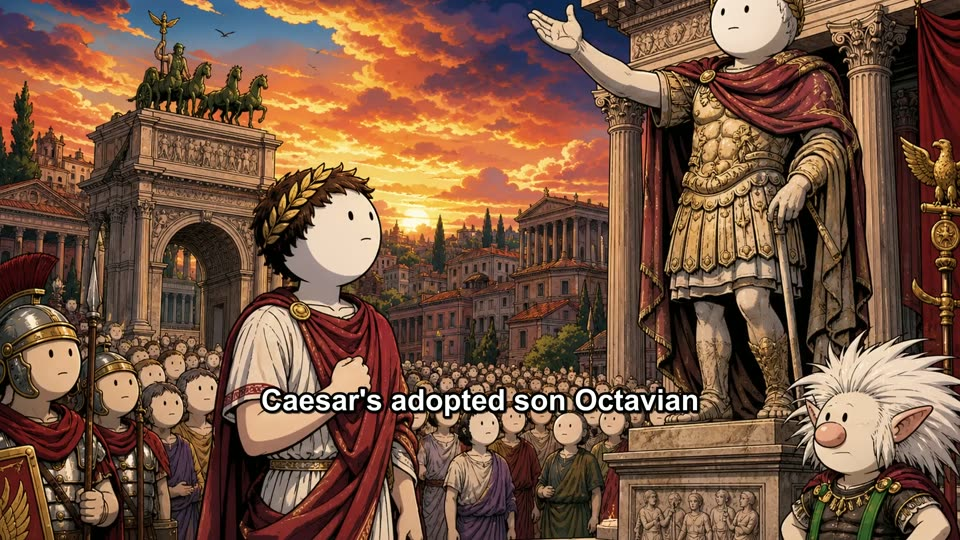
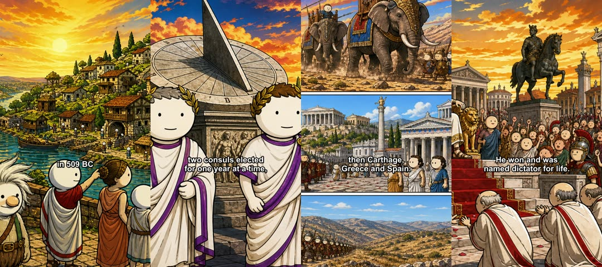
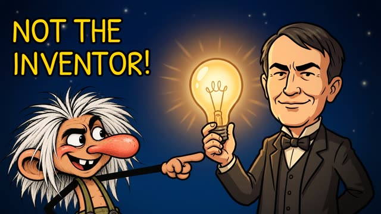
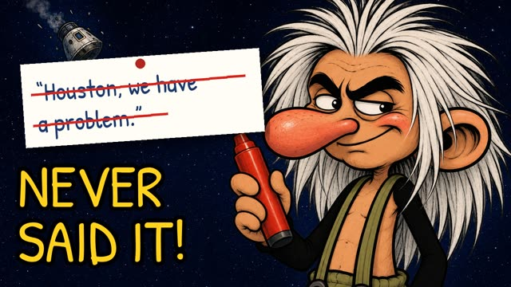
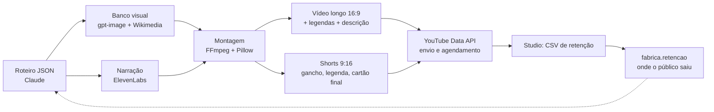

# Pipeline de vídeo com IA

Dois sistemas de edição de vídeo que construí em Python, com IA em cada etapa:

1. **Canal de história [The Myth Troll](https://www.youtube.com/@TheMythTroll)** (YouTube, em inglês): do roteiro ao vídeo publicado. Escreve o roteiro, gera as ilustrações, narra, monta o vídeo longo, corta os Shorts e agenda tudo pela API do YouTube.
2. **Cortes de podcast** (`podcast/`): transforma um episódio gravado em 30 Shorts, 5 cortes longos, 5 médios e capas. Uso em produção para um cliente.

> **English summary:** Two AI-powered video pipelines in Python. (1) A faceless YouTube history channel: Claude writes the script, gpt-image draws one illustration per sentence, ElevenLabs narrates, FFmpeg assembles the 16:9 video and the vertical Shorts, and the YouTube Data API schedules everything. (2) A podcast clipper used for a paying client: speaker diarization, face-tracking vertical crop (OpenCV YuNet), word-by-word captions, animated logo sting, and a ready-to-upload delivery folder.

## Resultado

| Vídeo longo (16:9) | Short (9:16), uma ilustração por frase |
| --- | --- |
|  |  |

Capas geradas pelo pipeline:

  

- 3 episódios publicados, cada um com 7 Shorts. Exemplos: [Who Ruled Italy](https://youtu.be/4_CfeSLyVeA) e [Wrong Inventors](https://youtu.be/uCsNsdAo85E).
- Shorts com 71 a 86% de retenção nos primeiros segundos, segundo o YouTube Studio, depois de ajustar os ganchos com `fabrica.retencao`.

## 1. Canal de história



| Módulo | O que faz |
| --- | --- |
| `fabrica/roteiro.py` | Valida o roteiro JSON (capítulos, frases, cenas) antes de gastar com imagem e voz |
| `fabrica/visual.py`, `cenas.py`, `commons.py` | Gera as cenas no estilo do mascote (gpt-image) e busca imagens de acervo com licença livre |
| `fabrica/recortes.py` | Formato atual: uma ilustração por frase, frase escrita na tela, cortes secos, série em Partes |
| `fabrica/montagem.py`, `clipes.py`, `camadas.py` | Monta o vídeo longo: narração, música com ducking, camadas e transições |
| `fabrica/shorts.py`, `vertical.py` | Corta os Shorts verticais com gancho, legenda queimada e cartão final |
| `fabrica/youtube.py` | Envia e agenda pela API do YouTube, com login OAuth renovado sozinho |
| `fabrica/referencias.py` | Acha vídeos fora da curva num tema (views ÷ mediana do próprio canal) |
| `fabrica/retencao.py` | Lê o CSV de retenção do Studio e mostra o que a narração dizia onde o público saiu |
| `historia/` | Roteiros publicados, poses do mascote, fontes e estilo |

```bash
python -m fabrica.recortes who-ruled-italy --musica "trilha.mp3"   # vídeo longo + Partes
python -m fabrica.shorts who-ruled-italy --musica "trilha.mp3" --inicio 2026-10-19
python -m fabrica.youtube who-ruled-italy                          # envia e agenda
```

## 2. Cortes de podcast

`podcast/cortes.py` lê duas coisas da pasta do episódio: `falantes.json`, a transcrição com quem fala cada palavra (ElevenLabs Scribe), e `edicao.json`, as decisões editoriais com os tempos de cada corte.

- **Reenquadramento vertical pelo rosto:** detecta rostos com OpenCV YuNet e segue quem está falando, sem trocar de plano em falas curtas ("uhum").
- **Legenda palavra a palavra** em ASS, com destaque na palavra dita.
- **Estrutura de Short que segura o público:** chamada forte, depois a pergunta do apresentador e então a resposta, com a vinheta do logo entrando por cima da fala.
- **Capa no primeiro quadro**, com título e destaque em `[colchetes]`, exportada também como `.capa.jpg`.
- **Entrega pronta:** pastas numeradas, legendas `.srt` e um LEIA-ME em PDF com títulos, descrições e calendário de postagem.
- **Reprodução lisa no celular:** GOP de 2 s, sem quadros B, áudio com carimbo de tempo regenerado. `verificar.py` confere isso antes da entrega.

```bash
python podcast/cortes.py EP01 roteiro    # confere texto e duração de cada corte sem renderizar
python podcast/cortes.py EP01 shorts
python podcast/cortes.py EP01 longos
python podcast/cortes.py EP01 entrega
```

A marca, os episódios e as transcrições do cliente não estão neste repositório. Para usar, coloque seu `logo.png` em `podcast/marca/` e rode `marca/animacao.py`.

## Rodar

```bash
pip install -r requirements.txt   # também precisa do FFmpeg no PATH
cp .env.example .env              # chaves da Anthropic, OpenAI e ElevenLabs
pytest
```

## Stack

Python, FFmpeg, Pillow, OpenCV, Claude (Anthropic), gpt-image (OpenAI), ElevenLabs (voz e transcrição), YouTube Data API.

## Autor

**Rodrigo Medeiros**: consultor de IA e automação e editor de vídeo, Rio de Janeiro. [LinkedIn](https://www.linkedin.com/in/rodrigo-r-244203161/)

Escrito com desenvolvimento assistido por IA (Claude Code), com direção editorial, testes e decisões de arquitetura meus. As ilustrações são geradas por IA a partir das poses originais do mascote, que também são minhas.
